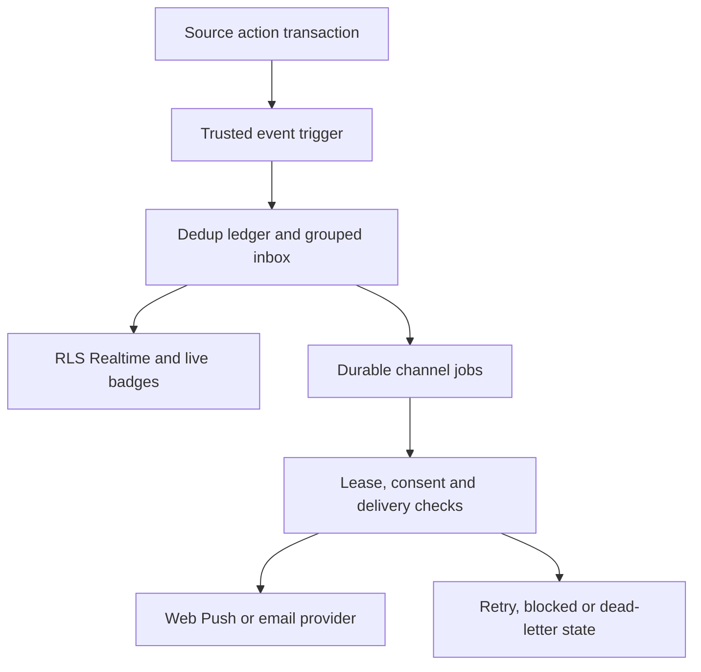

# Vegas Quant notification system

## What is implemented

A recipient-owned, transactional inbox replaces the header's announcements-only bell. Likes, comments, replies, @mentions, follows, successful post-link shares and comment reactions create notifications in the same transaction as their source action. Password changes and confirmed account-email changes originate from Auth triggers. Community access restrictions/restorations generate account warnings from the private moderation table. Welcome, weekly incomplete-profile reminders and recent feature announcements are lazily materialized for the signed-in recipient; no broadcast fanout on app-update insertion. Existing announcements remain in the archived updates dialog.

The center at `/notifications` supports search, type/unread filtering, stable keyset pagination, actor avatars, grouped activity, timestamps, read/unread/delete and mark-all-read. Viewed receipts are separate from read receipts and are recorded when cards enter the visible viewport. Per-record actions use the row's `updated_at` as a race cutoff: an interaction arriving after the displayed version remains unread. Mark-all uses the inbox's server snapshot, not the browser's clock.

One provider in the root layout owns the authenticated subscription, bell counters, heartbeat, focus recovery and toasts. It persists across client navigation. Realtime is recipient-filtered and protected by RLS; a 30-second visible-tab poll repairs missed badge updates, and focus/reconnect reloads authoritative counts. Medium-priority toasts are throttled to one per 15 seconds. Sounds and haptics are off until requested and remain subject to browser support and permission. No interrupting notification modal or logo screen is added.

Comments accept same-post `parent_id`, have reaction buttons, and can be loaded outside the latest 50 when addressed by a notification. Links carry post and comment IDs; opening one expands the thread and scrolls to the exact highlighted comment. Sharing opens the native share sheet, or copies the post link; only a successful share/copy records an interaction. It does not claim the link was delivered to a particular person.

## Event flow and data

| Store | Role |
|---|---|
| `public.notifications` | Recipient, actor snapshot, type, content/post/comment IDs, message, priority, group identity, event count, deep link, created/updated/read/viewed timestamps. |
| `public.notification_preferences` | Per-type mute list, opt-in push/email, optional sound/haptics, grouping window and quiet hours/timezone. Security/account inbox events cannot be muted. |
| `private.notification_events` | Unique `(recipient_id,event_key)` ledger, actor, projection reference and creation time. Retained independently from a deleted inbox card to reject replay. |
| `private.notification_deliveries` | Channel/device job, due time, lease token/expiry, attempts, outcome and sanitized error code. Not exposed through Realtime. |
| `private.notification_action_rates` | Atomic successful-attempt counters, including unlike/re-like toggles; per-user rows older than one day are cleaned on the next action. |
| `private.notification_presence` | Per-tab visible heartbeat with a 75-second freshness threshold; no public online directory. |

Source triggers determine recipients from stored ownership. Clients cannot insert notification records, choose recipients, edit message/type/content, invoke the system-event API or claim delivery jobs. Own read/view mutations and preferences use invoker RLS; trusted projections/queues use narrowly granted definer functions with an empty search path. Blocks are checked in both directions and remove grouped snapshots containing the blocked actor. Actor/account deletion cascades notification data. Deleted source posts/comments cascade associated inbox cards and jobs. No private messages or subscriber endpoints are published over Realtime.

## API contract

Authenticated Supabase RPCs:

- `notification_inbox(p_type,p_search,p_unread,p_before,p_id)` — up to 40 rows and server snapshot; next page uses the last `(updated_at,id)` tuple.
- `notification_counts()` — unread, unviewed and unread message-notification counts across the entire visible inbox, independent of pagination.
- `notification_action(p_action,p_id,p_before)` — `read`, `unread`, `read_all`, `view` or `delete`, scoped to the caller.
- `notification_view(p_ids,p_before)` — visible-card batch, maximum 40, caller only.
- `notification_pulse(p_device,p_visible)` — a caller-owned tab heartbeat.
- `notification_sync_updates()` — materialize authoritative welcome/profile/announcement events for the caller only.
- `community_comments(p_post,p_target)` — visible recent comments plus an exact addressed target, reactions and reply references.

Trusted server-only integration: `publish_system_notification(p_recipient,p_type,p_event_key,p_message,p_link,p_actor,p_content)`. The event key must identify the durable source event and be stable across retries. Do not expose this as a public HTTP notification-creation endpoint. Future messaging code must validate conversation membership and blocking before invoking it. `message`, `group_message`, `message_request`, `message_reminder`, `security`, `account`, `profile_reminder`, `feature` and `suggestion` have supported types. A service-role key is never shipped to a client.

`POST /api/notifications/social-dispatch` requires the existing vault-backed dispatcher secret. Workers claim at most 25 jobs with `FOR UPDATE SKIP LOCKED`, receive a unique lease, recheck recipient eligibility/preferences/read status before sending, and acknowledge only with that lease. Five provider requests run concurrently. A crashed lease becomes eligible again; five failed/exhausted attempts produce an inspectable dead letter. Retry delay backs off exponentially. Push 404/410 removes the expired subscription. Email requests use a stable provider idempotency key. Delivery is at-least-once; Web Push cannot promise exactly-once device display, so stable notification tags collapse repeated deliveries.

`GET /api/notifications/channels` reports configuration booleans only. No keys or contact addresses are returned.

## Priorities and volume controls

| Priority | Events | Behavior |
|---|---|---|
| Critical | DM/group/request, password/security/account | In-app immediately; opted-in push/email queued without quiet-hour deferral. Lock-screen/email copy is generic. |
| High | Comments, replies, mentions, shares | In-app immediately; opted-in push delayed briefly and deferred while a visible tab is active. |
| Medium | Likes, followers, comment reactions | In-app grouped into a configurable fixed 1–30 minute window (5 by default); one push per group. |
| Low | Welcome, profile/feature updates, suggestions | In-app only. |

Self-actions are ignored. Like/follow/share/reaction source identities dedupe repeated toggles, and mentions are limited to ten distinct valid usernames per publication. Existing post/comment source rate limits remain. New reaction/share/follow guards snapshot the server timestamp and permit at most 60 successful combined interaction attempts per actor/minute, including repeated toggles; a further notification cap suppresses more than 20 noncritical events from one actor to one recipient/minute. Indexed grouping, per-group delivery uniqueness, an hourly social-push budget, quiet hours and visible-tab deferral limit noise. Critical events bypass the social push budget. The ten-per-hour social budget is evaluated at dispatch; concurrent in-flight batches can briefly exceed it, so it is a burst-control target rather than an exactly serialized quota.

The new `vq-social-notifications` pg_cron job checks due work every ten seconds (deployed pg_cron 1.6.4); it does not alter research schedules or existing official/research push jobs. The app transaction never contacts a delivery provider. Online signals can be stale, and device/OS restrictions can delay push; do not promise that every notification is instantly displayed.

## Channel readiness and limits

- In-app/Realtime: implemented; persisted history repairs disconnects.
- Browser/mobile web push: implemented with existing VAPID registration. Requires the user to opt into social push and grant browser/OS permission; iPhone web push requires a supported installed Home Screen app. Provider acceptance is recorded, not a fictitious device-open receipt.
- Email: Resend adapter implemented, critical-only and opt-in. Requires `RESEND_API_KEY`, `NOTIFICATION_EMAIL_FROM`, a verified sending domain and provider delivery/bounce monitoring. Without configuration the UI disables enrollment and any trusted queued email is `blocked`, never marked sent.
- SMS: intentionally disabled; no SMS provider, verified-number consent or delivery claims. It is optional and should stay disabled until those are implemented.
- DMs/group messages/message requests/offline-message reminders: supported notification event contracts and counts exist, **but this repository has no messaging/conversation source tables or messenger UI**. No fake messages or badges are generated. Build the messaging service and invoke the trusted seam transactionally; add one deduped reminder per conversation/day only after an agreed delay, never by scanning all users.
- Security: password/account-email changes are wired. Other warnings, login anomaly detection and externally initiated account updates require their trusted source services to emit events.

## Operations and scale

`social_notification_health()` (service role only) returns aggregate queue state, oldest due time and total unread count. Monitor oldest due age, realtime reconnects, preference-save failures, claim/ack failures, 404/410 rates, blocked/dead counts, provider 429/5xx and read/open ratios. Never log raw endpoints, private messages, addresses, auth tokens or notification bodies. `retry_social_notification_delivery(p_id)` safely requeues only blocked/dead jobs after the cause is corrected; it cannot replay a sent job.

Current implementation fits Vegas Quant's deployed Postgres/Supabase/Vercel stack. It is **not a claim that this deployment has been load-tested for millions of users**. Scale in measured stages:

1. Load-test at expected active-session/event concurrency; measure WAL/replication lag, P95 inbox/count latency and queue delay. Target P95 in-app updates under two seconds during normal connectivity and due-job pickup under twenty seconds; measure rather than advertise them as guarantees.
2. Move high-volume realtime fanout to private per-user Broadcast channels and horizontally scaled WebSocket gateways. Supabase Postgres Changes evaluates subscriber authorization and is not the final million-user transport. Keep the inbox and catch-up API as source of truth.
3. Shard consumers by recipient hash; partition event/delivery history by time. Replace cron HTTP wakeups with continuous queue consumers when due-age or sustained event rate warrants it. Preserve per-device idempotency and lease acknowledgments across shards.
4. Introduce transactional unread counters only with reconciliation and row-lock/load tests; current indexed unread counts prioritize correctness. Use read replicas/search indexing after measured need; never allow stale replicas to authorize delivery.
5. Set an explicit retention policy before pruning event keys. A starting proposal is 90 days inbox history plus archived exports, 30 days successful delivery diagnostics, and source-lifetime reaction dedup keys. This implementation preserves history and does not silently delete old notifications.
6. For high-fanout announcements keep lazy materialization. Never insert millions of per-user rows in the publishing transaction. Use resumable cursor jobs for mandatory security campaigns.
7. Add bounce/complaint/unsubscribe webhooks, a provider failover plan, a circuit breaker and alerting before promoting email to a critical operational dependency. SMS needs verified consent, provider webhooks, spend caps and local quiet-hour rules before launch.

## Verification

`tests/sql/social-notifications.mjs` runs real Postgres semantics through PGlite: ownership isolation, client spoof rejection, self-action suppression, dedup/group counts, mentions, replies, blocks, preferences, password events, leases and consent rechecks. `tests/notifications.test.ts` covers readable grouping, safe deep links, provider-unconfigured/retry states and service-worker destinations; existing push tests remain required. Browser smoke checks cover mobile/desktop badges, search, read/unread, preferences and comment deep links using fixtures. No tests send messages to real members or modify research records.
